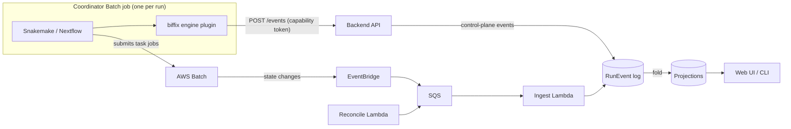

# Architecture

biffix is a control plane for Snakemake and Nextflow workflows on AWS. It registers workflow
versions, launches runs, and shows what each run is doing and what it produced. It does not
execute DAGs. Each run is one coordinator AWS Batch job that runs the engine, and the engine's own
AWS Batch executor submits, retries and reaps the task jobs. biffix builds the thin layer around
that: registration, a launch form, run tracking, provenance, cost estimates, and the AWS
infrastructure to host it all in one account.

This page explains how the pieces fit and the design rules they follow. For deploying, see
[deploying.md](deploying.md); for writing and running workflows, see [user-guide.md](user-guide.md).

## The core idea: one event log, everything else is a fold

Every fact biffix learns about a run is appended to one immutable log of normalized `RunEvent`s
in Postgres (Aurora in a deployment). Everything the UI, the CLI and the provenance export show
is a *projection* of that log: a deterministic fold of the run's events in timestamp order.

The invariant is `projection == fold(events in ts order)`. An incremental fold (applying events
as they arrive) and a full replay give the same result. That has practical consequences:

- A projection is a cache that can be dropped and rebuilt from the log.
- A projection bug is fixed in the reducer and the affected runs are replayed. Nobody patches rows
  by hand, because a patched row would disagree with the next replay.
- Late, duplicate and out-of-order events need no special handling. Each event carries a
  deterministic `dedup_key`, so a re-delivery is a no-op, and its `ts` records when the described
  thing happened, so delivery order does not matter.
- Provenance cannot drift from the UI: the RO-Crate a run exports and the run page fold the same
  events (see [provenance.md](provenance.md)).
- Cost, failure classification, per-sample progress and notifications are more folds over the
  same log, so adding a view needs no change to ingestion.

### Producers

Three kinds of producer append to the log:

- **The engine plugins** inside the coordinator: the Snakemake logger plugin
  (`plugins/snakemake-logger-plugin-biffix`) and the Nextflow plugin (`plugins/nf-biffix`). They
  POST engine events (run started, DAG, task created and submitted, outputs) to the API's
  `/events` route, authenticated by a per-run capability token. Each plugin also writes every
  event to a local `events.jsonl` that the coordinator uploads and replays at exit, so an event a
  live POST dropped still arrives.
- **AWS itself.** AWS Batch job state changes, EC2 spot interruption warnings and CodeBuild state
  changes arrive through EventBridge into an SQS queue. They carry what the engine cannot know:
  exit codes, the host a task ran on, spot reclaims.
- **The control plane.** The backend appends its own events: a run was submitted, cancelled,
  renamed, moved into an experiment. The reconcile Lambda's retention sweep reports a deleted work
  directory the same way, through the ingest queue.

The ingest Lambda drains the SQS queue, translates each source's wire format into a `RunEvent`,
drops duplicates by `dedup_key`, appends, and advances the projections. A scheduled reconcile
Lambda is the backstop: it finds attempts whose terminal event never arrived and asks AWS, and it
also refreshes prices, runs the status probe, and deletes intermediate files whose retention has
passed.

### Join keys

Two streams describe the same task from different vantage points. The engine knows the rule or
process and its wildcards; AWS knows the exit code, the host and whether spot took it away. They
are joined on a few keys:

- **`batch_job_id`** joins the engine stream to the AWS stream. The engine plugin's
  `task_submitted` event publishes the binding from a task to the Batch job running it.
- **`task_key`** names a logical task and stays stable across retries: `rule:sorted(wildcards)`
  for Snakemake, the process and tag for Nextflow. A retry is a new attempt under the same
  `task_key`.
- **`run_id`** is nullable. An AWS event can arrive before biffix has seen the `task_submitted`
  that says which run the job belongs to; it is stored unattributed and stitched in when the
  binding arrives.

The binding is security-relevant: whoever claims a job first takes its AWS facts. The `/events`
route accepts a `task_submitted` only when the Batch job's `biffix:run` tag names the claiming
run, no other run already claims it, and its timestamp is plausible.

One known limitation: Snakemake wildcard values are joined into the `task_key` without escaping,
so a value containing `,` or `=` can give two tasks the same key. Changing that is a contract
change for every producer and consumer, so it will be revisited only if a real workflow hits it.

## Components

### Rust crates (`crates/`)

| Crate | What it holds |
|---|---|
| `biffix-core` | The event contract and its folds: `RunEvent`, per-source wire formats and their translators, the EventBridge decoders, the dedup keys, the reducer (the fold), the failure classifier, and small shared helpers (env, capability tokens, S3 layout). Every other crate depends on it; it depends on none. No I/O. |
| `biffix-workflow` | Workflow authoring and registration, built on `biffix-core`: the `biffix.yaml` manifest, FormSchema and its validator, samples, images, engine and runtime pins, and the version hash. Used by the backend, the API types, the CLI and `xtask`; the ingest Lambdas do not link it. No network, database or AWS access; it reads only a local workflow tree. |
| `biffix-db` | Postgres access shared by the backend and ingest: the SQL migrations (`crates/biffix-db/migrations/`), the event log, and the projection writers. |
| `biffix-api` | The HTTP API's request and response types, shared by the backend and the CLI. |
| `biffix-backend` | The axum HTTP API (a Lambda in a deployment), registration, the submit pipeline, RBAC, the AWS provider, and the scheduled sweep. AWS and Postgres code sit behind the `aws` feature. |
| `biffix-ingest` | The SQS drain Lambda and the scheduled reconcile Lambda. |
| `biffix-cli` | The `biffix` command-line client. |

`xtask/` holds repository tooling (`cargo xtask emit-schemas` writes `schemas/*.json` from the
Rust types).

### Coordinator image (`docker/coordinator`)

One base image serves as the coordinator and, for a Snakemake version with no image of its own,
as the task image. It has no `ENTRYPOINT`; the Batch job definition picks the role.
`entrypoint.sh` documents the environment the backend injects (`BIFFIX_RUN_ID`, `BIFFIX_ENGINE`,
`BIFFIX_PARAMS`, and so on). The base image carries no Snakemake or Nextflow: each workflow
version pins an engine release, and a CodeBuild project builds that release into a runtime layer
on top of the base. Versions pinning the same release share it.

The image is built in CI for both x86 and Graviton and tagged by commit or release, in an
immutable ECR repository, so a tag always means the same bytes.

### Engine plugins (`plugins/`)

- [`snakemake-logger-plugin-biffix`](../plugins/snakemake-logger-plugin-biffix/README.md) maps
  Snakemake's log records to biffix engine events.
- [`nf-biffix`](../plugins/nf-biffix/README.md) reports Nextflow's run and task lifecycle,
  resolves each task's container through the run's image map, and tags every Nextflow job
  definition with the run's project.

Both emit the same wire contract, `schemas/wire.engine.schema.json`, and are shipped inside the
coordinator's runtime layer. A pipeline does not list them.

### Web UI (`ui/`)

A SvelteKit app (Svelte 5) built to static files and served from S3 through CloudFront. It has
two views of the same data: the **Lab** view, for people who launch pipelines and read results,
and the **Expert** view, which adds the engine-level detail (jobs, DAG, coordinator log, cost,
parameters). The API types in `ui/src/lib/generated/` are generated from the backend's OpenAPI
document, and CI fails if they drift.

### Infrastructure (`infra/`)

A CDK app in Python. One deployment is one tenant in one AWS account. Its stacks are split by
lifecycle:

| Stack | What it creates |
|---|---|
| network | VPC, subnets, NAT |
| data | the shared reference bucket, ECR repositories, the image archive |
| identity | the Cognito user pool and clients, base IAM roles and the permissions boundary |
| compute | AWS Batch compute environments and queues, one per configured queue-class |
| build | CodeBuild projects that build engine runtimes and import or build workflow images |
| project-&lt;id&gt; | one per project: its bucket, KMS key and run role |
| persistence | Aurora (the event store) and the capability-token signing secret |
| ingest | the SQS queue and dead-letter queue, the ingest and reconcile Lambdas |
| api | the backend Lambda, the HTTP API with its Cognito authorizer, per-project coordinator roles and job definitions, the sweep |
| edge | CloudFront and the private UI bucket |

[infra/README.md](../infra/README.md) is the operational reference for each.

## Design principles

These are the rules the design keeps. When a change seems to need breaking one, that is a signal
to step back.

### Do not build a scheduler

Snakemake and Nextflow already have AWS Batch executors that submit, retry and reap jobs, and
they handle wildcards, checkpoints, dynamic rules and caching in ways a reimplementation would
spend years matching. biffix launches one coordinator job per run and lets the engine drive the
DAG. Everything biffix knows about task progress comes from the engine plugins and AWS events,
never from running the DAG itself.

### Manage AWS through AWS

Anything AWS already owns (Batch compute environments and queues, IAM roles, the Cognito pool,
S3 buckets and lifecycle rules, KMS keys, ECR) is created and changed through CDK, the console or
the AWS CLI, never through a biffix screen. Identity works the same way: users and group
membership live in Cognito or the upstream identity provider, and biffix stores only the mapping
from groups to biffix roles. biffix manages its own objects (workflows, versions, runs,
experiments, reference bundles) and keeps no mirror of AWS state that could drift.

### IAM is the authorization engine

biffix does not invent an authorization mechanism that a bug could bypass. Isolation is layered:

- **The account is the tenant boundary.** One deployment per account.
- **A project is its own bucket, KMS key and roles.** A run's tasks run as the project's run
  role; the coordinator runs as the project's coordinator role, which may submit, tag and
  terminate only jobs tagged with its own project and pass only its own project's run role.
- **No long-lived secrets in containers.** No AWS credentials are forwarded into a run. The only
  secret a run carries is its capability token, which is signed, expires, and authorizes the
  engine plugin's event POSTs for that one run.

The backend's role checks (Viewer, Operator, Developer, Admin) are defense in depth. IAM is the
boundary that holds when application code is wrong.

### Schema to form

Lab users should never write engine config. The launch form is generated from the workflow's own
parameter schema (an nf-schema `nextflow_schema.json`, or a JSON Schema for a Snakemake config),
normalized into one internal FormSchema, and curated by the author in `biffix.yaml`. The UI
checks the form with a TypeScript port of the server's validator (`ui/src/lib/launch/validate.ts`)
that replays the server's own test cases (`schemas/validate-cases.json`), so a validator change is
made in Rust and mirrored in the port. The server's verdict is authoritative.

### Spot, with two retry layers

Spot capacity is the main cost lever, so task jobs run on spot by default. The coordinator never
does: a head job that runs for hours must not be reclaimed. Retries are split so nothing retries
twice:

- **Infrastructure interruptions** (a spot reclaim, a lost host) are retried by AWS Batch's own
  `retryStrategy`. That is invisible to the engine and keeps the same `batch_job_id`.
- **Application failures** are retried by the engine (`retries:` in Snakemake, `errorStrategy` in
  Nextflow). Each retry is a new Batch job, which biffix shows as a new attempt of the same task.

The event model carries spot warnings and termination categories, so the UI can say a task is
retrying after a reclaim rather than showing it as failed.

### Ready for regulated data

The architecture is meant not to rule out a deployment handling protected health information.
It uses services AWS lists as HIPAA-eligible, encrypts data at rest with customer-managed KMS keys
by default, requires TLS to buckets, isolates projects, keeps secrets out of the event log
(secret parameters are redacted before they are recorded), and lets workflows use opaque sample
identifiers so names, tags and events need not carry personal data. Workers can be restricted to
VPC endpoints with no internet route (`worker_egress: ecr_s3_only`).

None of this makes a deployment compliant. biffix does not provision an audit trail (a CloudTrail
trail, CloudFront access logs, an application access log) out of the box, and running regulated
data needs a Business Associate Agreement with AWS, those audit controls, and your own review.

### Fix it upstream, not in a fork

When a gap is really in Snakemake or Nextflow tooling, the fix belongs upstream: an executor
feature, a logger plugin, a richer parameter schema. biffix carries a local workaround only while
the upstream change is in review.

The one current exception is the Snakemake AWS Batch executor. The coordinator installs it from a
fork pinned to an exact commit (`docker/coordinator/wheels.env`). The fork is upstream plus open
pull requests biffix depends on: job-state events that carry the Batch job id, a strict container
image map (a task naming an unmapped image fails instead of pulling it), and a per-project task
log group. Other features biffix uses, such as per-rule queues and spot retry attempts, are
already upstream. The pin moves back to an upstream release once those pull requests merge.

## The RunEvent contract

The `RunEvent` schema is a public, versioned API: the engine plugins, the AWS translators, the
reducer, the UI and the provenance exporter all bind to it, and some producers (an engine plugin
built into an older runtime) are released on a different schedule from the backend. It therefore
changes like a wire protocol.

- **Two layers.** Each producer has its own wire format (the engine plugins post the one in
  `schemas/wire.engine.schema.json`; AWS events arrive as EventBridge JSON), and a thin translator
  maps it to the normalized `RunEvent` (`schemas/runevent.schema.json`) that the log stores. A
  plugin author only needs the engine wire schema.
- **Additive only.** New optional fields, new `data` fields, new `kind`s and new `source`s are
  added without a version bump. Removing or renaming a field, changing a type, or changing what an
  existing `kind` means is a breaking change, and a retired name is never reused.
- **Consumers tolerate the unknown.** Unknown fields are ignored. An event of an unknown `kind` or
  `source` is stored, but not folded. Because the log is immutable, old events are never rewritten;
  a newer reducer reinterprets them at fold time.
- **Open enums.** `kind` and `source` are strings, so a new engine adapter does not force a
  contract change.
- **Engine kinds are namespaced.** The `/events` route accepts the known engine kinds, plus
  unknown kinds only when they start with `engine_`, which are stored but not folded. No
  control-plane or AWS kind may use that prefix, so a plugin can never append an event a later
  build would read as a control-plane fact. A known limitation: such an event is stored with its
  whole wire body nested under `raw` and only `run_id` lifted, so once the backend is upgraded to
  a build that knows the kind, the stored row reads as a degraded known kind and is still not
  folded (nothing re-translates it, and the plugins send each event once). Upgrade the backend
  before the plugins that emit a new engine kind. An AWS Batch status, EC2 event or CodeBuild
  status the translator does not know is stored the same way, and its dedup key keeps a later
  redelivery from replacing it.
- **Control-plane kinds fold only from the control plane.** A `run_submitted` or `run_cancelled`
  from any other source is kept in the log but moves no projection.
- **Secrets never enter the log.** A parameter marked secret is redacted before `run_submitted`
  is recorded.

The JSON Schemas in `schemas/` are generated from the Rust types and checked for drift in CI.
[developing.md](developing.md#changing-the-contract) lists what to update when the contract
changes.
