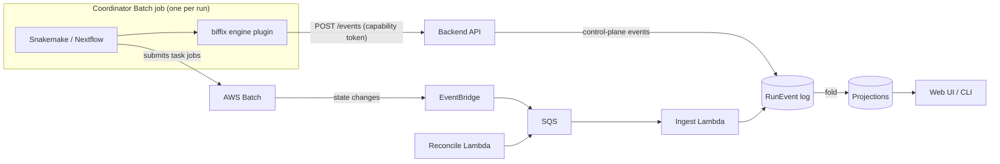

# Architecture

biffix is a control plane for Snakemake and Nextflow workflows on AWS. It registers workflow
versions, launches runs, and shows what each run is doing and what it produced. It does not
execute DAGs. Each run is one coordinator AWS Batch job that runs the engine, and the engine's own
AWS Batch executor submits, retries and reaps the task jobs. biffix builds the thin layer around
that: registration, a launch form, run tracking, provenance, cost estimates, and the AWS
infrastructure to host it all in one account.

This page explains how the pieces fit and the design rules they follow. For deploying, see
[deploying.md](deploying.md); for writing and running workflows, see [user-guide.md](user-guide.md).

## The core idea: one event log, everything else is a fold

Every fact biffix learns about a run is appended to one immutable log of normalized `RunEvent`s
in Postgres (Aurora in a deployment). Everything the UI, the CLI and the provenance export show
is a *projection* of that log: a deterministic fold of the run's events in timestamp order.

The invariant is `projection == fold(events in ts order)`. An incremental fold (applying events
as they arrive) and a full replay give the same result. That has practical consequences:

- A projection is a cache that can be dropped and rebuilt from the log.
- A projection bug is fixed in the reducer and the affected runs are replayed. Nobody patches rows
  by hand, because a patched row would disagree with the next replay.
- Late, duplicate and out-of-order events need no special handling. Each event carries a
  deterministic `dedup_key`, so a re-delivery is a no-op, and its `ts` records when the described
  thing happened, so delivery order does not matter.
- Provenance cannot drift from the UI: the RO-Crate a run exports and the run page fold the same
  events (see [provenance.md](provenance.md)).
- Cost, failure classification, per-sample progress and notifications are more folds over the
  same log, so adding a view needs no change to ingestion.

### Producers

Three kinds of producer append to the log:

- **The engine plugins** inside the coordinator: the Snakemake logger plugin
  (`plugins/snakemake-logger-plugin-biffix`) and the Nextflow plugin (`plugins/nf-biffix`). They
  POST engine events (run started, DAG, task created and submitted, outputs) to the API's
  `/events` route, authenticated by a per-run capability token. Each plugin also writes every
  event to a local `events.jsonl` that the coordinator uploads and replays at exit, so an event a
  live POST dropped still arrives.
- **AWS itself.** AWS Batch job state changes, EC2 spot interruption warnings and CodeBuild state
  changes arrive through EventBridge into an SQS queue. They carry what the engine cannot know:
  exit codes, the host a task ran on, spot reclaims.
- **The control plane.** The backend appends its own events: a run was submitted, cancelled,
  renamed, moved into an experiment. The reconcile Lambda's retention sweep reports a deleted work
  directory the same way, through the ingest queue.

The ingest Lambda drains the SQS queue, translates each source's wire format into a `RunEvent`,
drops duplicates by `dedup_key`, appends, and advances the projections. A scheduled reconcile
Lambda is the backstop: it asks AWS about jobs whose terminal event has not arrived (and the
still-live children of ended runs), and records their terminal and, when the log lacks it, their
start. A known limit: a job whose terminal arrived but whose start was lost is not asked about
again, so its start is not repaired. The Lambda also refreshes prices, runs the status probe, and
deletes intermediate files whose retention has passed.

A run can also execute as **one** Batch job on one host ([single-job runs](#single-job-runs)): the
engine runs every task on that host, each in the image its Batch job would run, and AWS reports
only that one job.

### Join keys

Two streams describe the same task from different vantage points. The engine knows the rule or
process and its wildcards; AWS knows the exit code, the host and whether spot took it away. They
are joined on a few keys:

- **`batch_job_id`** joins the engine stream to the AWS stream. The engine plugin's
  `task_submitted` event publishes the binding from a task to the Batch job running it.
- **`task_key`** names a logical task and stays stable across retries: `rule:sorted(wildcards)`
  for Snakemake, the process and tag for Nextflow. A retry is a new attempt under the same
  `task_key`.
- **`run_id`** is nullable. An AWS event can arrive before biffix has seen the `task_submitted`
  that says which run the job belongs to; it is stored unattributed and stitched in when the
  binding arrives.

The binding is security-relevant: whoever claims a job first takes its AWS facts. The `/events`
route accepts a `task_submitted` only when the Batch job's `biffix:run` tag names the claiming
run, no other run already claims it, and its timestamp is plausible.

One known limitation: Snakemake wildcard values are joined into the `task_key` without escaping,
so a value containing `,` or `=` can give two tasks the same key. Changing that is a contract
change for every producer and consumer, so it will be revisited only if a real workflow hits it.

## Components

### Rust crates (`crates/`)

| Crate | What it holds |
|---|---|
| `biffix-core` | The event contract and its folds: `RunEvent`, per-source wire formats and their translators, the EventBridge decoders, the dedup keys, the reducer (the fold), the failure classifier, and small shared helpers (env, capability tokens, S3 layout). Every other crate depends on it; it depends on none. No I/O. |
| `biffix-workflow` | Workflow authoring and registration, built on `biffix-core`: the `biffix.yaml` manifest, FormSchema and its validator, samples, images, engine and runtime pins, and the version hash. Used by the backend, the API types, the CLI and `xtask`; the ingest Lambdas do not link it. No network, database or AWS access; it reads only a local workflow tree. |
| `biffix-db` | Postgres access shared by the backend and ingest: the SQL migrations (`crates/biffix-db/migrations/`), the event log, and the projection writers. |
| `biffix-api` | The HTTP API's request and response types, shared by the backend and the CLI. |
| `biffix-backend` | The axum HTTP API (a Lambda in a deployment), registration, the submit pipeline, RBAC, the AWS provider, and the scheduled sweep. AWS and Postgres code sit behind the `aws` feature. |
| `biffix-ingest` | The SQS drain Lambda and the scheduled reconcile Lambda. |
| `biffix` (`crates/biffix-cli`) | The `biffix` command-line client. |

`xtask/` holds repository tooling (`cargo xtask emit-schemas` writes `schemas/*.json` from the
Rust types).

### Coordinator image (`docker/coordinator`)

One base image serves as the coordinator and, for a Snakemake version with no image of its own,
as the task image. It has no `ENTRYPOINT`; the Batch job definition picks the role.
`entrypoint.sh` documents the environment the backend injects (`BIFFIX_RUN_ID`, `BIFFIX_ENGINE`,
`BIFFIX_PARAMS`, and so on). On x86_64 it also carries a non-setuid Apptainer, which a
[single-job run](#single-job-runs) runs its tasks with. The base image carries no Snakemake or
Nextflow: each workflow version pins an engine release, and a CodeBuild project builds that
release into a runtime layer on top of the base. Versions pinning the same release share it.

The image is built in CI for both x86 and Graviton and tagged by commit or release, in an
immutable ECR repository, so a tag always means the same bytes.

### Engine plugins (`plugins/`)

- [`snakemake-logger-plugin-biffix`](../plugins/snakemake-logger-plugin-biffix/README.md) maps
  Snakemake's log records to biffix engine events.
- [`snakemake-executor-plugin-biffix`](../plugins/snakemake-executor-plugin-biffix/README.md) is
  the Snakemake executor of a [single-job run](#single-job-runs): it runs each job, or group job,
  on the coordinator's host, in the image the AWS Batch executor would pick for it.
- [`nf-biffix`](../plugins/nf-biffix/README.md) reports Nextflow's run and task lifecycle,
  resolves each task's container through the run's image map, and runs each task on the job
  definition biffix registered for its image.

The logger and nf-biffix emit the same wire contract, `schemas/wire.engine.schema.json`. All
three are shipped inside the coordinator's runtime layer. A pipeline does not list them.

### Web UI (`ui/`)

A SvelteKit app (Svelte 5) built to static files and served from S3 through CloudFront. It has
two views of the same data: the **Lab** view, for people who launch pipelines and read results,
and the **Expert** view, which adds the engine-level detail (jobs, DAG, coordinator log, cost,
parameters). The API types in `ui/src/lib/generated/` are generated from the backend's OpenAPI
document, and CI fails if they drift.

### Infrastructure (`infra/`)

A CDK app in Python. One deployment is one tenant in one AWS account. Its stacks are split by
lifecycle:

| Stack | What it creates |
|---|---|
| network | VPC, subnets, NAT |
| data | the shared reference bucket, ECR repositories, the image archive |
| identity | the Cognito user pool and clients, base IAM roles and the permissions boundary |
| compute | AWS Batch compute environments and queues, one per configured queue-class |
| build | CodeBuild projects that build engine runtimes and import or build workflow images |
| project-&lt;id&gt; | one per project: its bucket, KMS key and run role |
| persistence | Aurora (the event store) and the capability-token signing secret |
| ingest | the SQS queue and dead-letter queue, the ingest and reconcile Lambdas |
| api | the backend Lambda, the HTTP API with its Cognito authorizer, per-project coordinator roles and job definitions, the sweep |
| edge | CloudFront and the private UI bucket |

[infra/README.md](../infra/README.md) is the operational reference for each.

## Design principles

These are the rules the design keeps. When a change seems to need breaking one, that is a signal
to step back.

### Do not build a scheduler

Snakemake and Nextflow already have AWS Batch executors that submit, retry and reap jobs, and
they handle wildcards, checkpoints, dynamic rules and caching in ways a reimplementation would
spend years matching. biffix launches one coordinator job per run and lets the engine drive the
DAG. Everything biffix knows about task progress comes from the engine plugins and AWS events,
never from running the DAG itself.

### Manage AWS through AWS

Anything AWS already owns (Batch compute environments and queues, IAM roles, the Cognito pool,
S3 buckets and lifecycle rules, KMS keys, ECR) is created and changed through CDK, the console or
the AWS CLI, never through a biffix screen. Identity works the same way: users and group
membership live in Cognito or the upstream identity provider, and biffix stores only the mapping
from groups to biffix roles. biffix manages its own objects (workflows, versions, runs,
experiments, reference bundles) and keeps no mirror of AWS state that could drift.

### IAM is the authorization engine

biffix does not invent an authorization mechanism that a bug could bypass. Isolation is layered:

- **The account is the tenant boundary.** One deployment per account.
- **A project is its own bucket, KMS key and roles.** A run's tasks run as the project's run
  role; the coordinator runs as the project's coordinator role, which may submit, tag and
  terminate only jobs tagged with its own project, and submit them only on its own project's
  task job definitions.
- **The backend, not workflow code, registers task job definitions.** A job definition decides
  whether a container is privileged and which host paths and devices it sees, and the compute
  environments are shared by every project, so the coordinator (which runs the workflow's code)
  may not register, deregister or tag one. At the launch of a run of one Batch job per task, the
  backend registers one per (project, image, engine), reused across runs: never privileged, with
  no volumes or devices beyond the read-only host AWS CLI Nextflow's tasks stage files with,
  running as the project's run role and logging to its task log group. IAM limits the backend to
  that name prefix, tenant ECR images and unprivileged definitions, and the hosts' ECS agents
  refuse privileged containers too. The run's coordinator gets a map of image to definition, and
  the engines submit every task on its image's definition. A single-job run registers none: its
  tasks run inside its one job, whose definition (an `sj-` clone of the project's single-job
  template) carries that template's `/dev/fuse` and host `/scratch` volume.
- **A single-job run runs as its project's run role.** It submits no Batch job, so it gets
  none of the coordinator role's Batch permissions, only the run role's (its project's bucket,
  key and data sources) and pulls from the tenant's image repositories, to convert task images
  on its host. See [single-job runs](#single-job-runs).
- **No long-lived secrets in containers.** No AWS credentials are forwarded into a run. The only
  secret a run carries is its capability token, which is signed, expires, and authorizes the
  engine plugin's event POSTs for that one run.

The backend's role checks (Viewer, Operator, Developer, Admin) are defense in depth. IAM is the
boundary that holds when application code is wrong.

### Schema to form

Lab users should never write engine config. The launch form is generated from the workflow's own
parameter schema (an nf-schema `nextflow_schema.json`, or a JSON Schema for a Snakemake config),
normalized into one internal FormSchema, and curated by the author in `biffix.yaml`. The UI
checks the form with a TypeScript port of the server's validator (`ui/src/lib/launch/validate.ts`)
that replays the server's own test cases (`schemas/validate-cases.json`), so a validator change is
made in Rust and mirrored in the port. The server's verdict is authoritative.

### Spot, with two retry layers

Spot capacity is the main cost lever, so task jobs run on spot by default. The coordinator never
does: a head job that runs for hours must not be reclaimed. Retries are split so nothing retries
twice:

- **Infrastructure interruptions** (a spot reclaim, a lost host) are retried by AWS Batch's own
  `retryStrategy`. That is invisible to the engine and keeps the same `batch_job_id`.
- **Application failures** are retried by the engine (`retries:` in Snakemake, `errorStrategy` in
  Nextflow). In a run of one Batch job per task, each retry is a new Batch job, which biffix shows
  as a new attempt of the same task. In a single-job run, the engine retries the task inside the
  run's one Batch job, on the same host.

The event model carries spot warnings and termination categories, so the UI can say a task is
retrying after a reclaim rather than showing it as failed.

### Ready for regulated data

The architecture is meant not to rule out a deployment handling protected health information.
It uses services AWS lists as HIPAA-eligible, encrypts data at rest with customer-managed KMS keys
by default, requires TLS to buckets, isolates projects, keeps secrets out of the event log
(secret parameters are redacted before they are recorded), and lets workflows use opaque sample
identifiers so names, tags and events need not carry personal data. Workers can be restricted to
VPC endpoints with no internet route (`worker_egress: ecr_s3_only`); a single-job host is not (it
is a run's coordinator as well as its tasks' host, and keeps the NAT).

A single-job run's working files (a Nextflow run's work directory; a Snakemake run's local copies of
its inputs and outputs, every output still being published to the run's output prefix) are on its
host's instance-store NVMe disks, which AWS encrypts in hardware with keys that are not the
project's KMS key and are discarded with the instance; the files do not outlive the host. A
deployment that must keep every byte under its own keys should not define a single-job queue-class.

None of this makes a deployment compliant. biffix does not provision an audit trail (a CloudTrail
trail, CloudFront access logs, an application access log) out of the box, and running regulated
data needs a Business Associate Agreement with AWS, those audit controls, and your own review.

### Single-job runs

A run that fits on one host can execute as one Batch job (`single_job` at submit, for a version
whose `biffix.yaml` allows it). The engine still drives the DAG; biffix schedules nothing.
Nextflow runs its tasks with its local executor. Snakemake has no local executor that forms group
jobs or runs a job inside an image as its AWS Batch executor does, so its jobs go through biffix's
own executor plugin (`plugins/snakemake-executor-plugin-biffix`): a remote executor, for which
Snakemake forms group jobs and merges their resources exactly as for AWS Batch, that starts each
job's own Snakemake (`python -m snakemake …`, the command a Batch job would run) as a process on
the host, in the job's image. Snakemake's scheduler still decides what runs when, within the
host's CPUs and memory. What changes is where the tasks run, and the isolation that holds around
them:

- **One run per host.** Single-job runs go to a dedicated compute environment of exact instance
  types, on-demand only, never shared with task queues, and each asks for its host's whole
  allocatable vCPUs and memory, so two runs (of any projects) never share a host. The isolation
  boundary stays the project, enforced by IAM: the job runs as the project's run role. IAM also
  keeps the two kinds of coordinator apart: single-job variants are named apart from tasks-mode
  ones, a single-job job is born tagged `biffix:execution=single_job`, and the control plane may
  submit a tagged job only to a single-job queue on a single-job variant and an untagged one only
  to the coordinator queue on a tasks-mode variant. A host is reused for later runs, so the
  coordinator wipes the host's `/scratch` before it stages anything (and refuses to run unless
  the host's boot, once it mounted the instance store there, wrote its marker outside `/scratch`,
  which the job sees read-only and a run cannot forge), and again at the end unless a signal
  stopped it (then the next run clears it). The deploy config allows one instance size per
  single-job queue-class, which is what keeps a whole-host request from fitting twice on a larger
  type; the backend relies on that rule.
- **Nested containers without privilege.** Each task runs in the image its Batch job would run (a
  Nextflow process's `container`; a Snakemake rule's `aws_batch_container_image` through the image
  map, else the version's default image), converted before the run, through a non-setuid Apptainer
  inside the job's container, which is not privileged and gets only `/dev/fuse`, the host's
  `/scratch` and, read-only, the directory of the boot's instance-store marker. An image the run's
  map does not name fails a Snakemake run before any task starts (every rule's image is resolved
  first), and a Nextflow run when the process that names it is dispatched (nf-biffix's container
  resolver), so earlier processes may already have run and published outputs. Either way no image
  is pulled while it runs.
  Apptainer needs to create a user namespace and mount inside it, which Docker's default seccomp
  profile refuses, so these hosts' Docker daemon uses that profile plus `mount`, `umount2`,
  `unshare` and `setns`. The relaxation grants no host capability, and container root still cannot
  get past Docker's `/proc` masking (tested), but it exposes kernel code reachable through user
  namespaces, the class of past `nf_tables` and overlayfs vulnerabilities. It is confined to the
  dedicated single-job hosts, which run one run at a time. They run the newest ECS-optimized Amazon
  Linux 2023 AMI as of their compute environment's last infrastructure update. Redeploying
  unchanged inputs makes no such update, so taking a kernel fix is an explicit refresh and a check
  of the replacement hosts' AMI (`infra/README.md`, "Taking a kernel fix on single-job hosts").
  Rejected alternatives (each tested or ruled out): the Docker socket (root on the host),
  privileged containers or rootless Podman with privileges (host root by another name), unmasking
  `/proc` (let container root write the host's `/proc/sysrq-trigger`), and Sysbox or gVisor (not
  supported by ECS).
- **Tasks share the job's process space and limits.** A task sees the job container's processes (not
  the host's) and a `/tmp` (also its `$TMPDIR`) on the host's disk that the run's tasks share.
  cgroups are read-only inside the container, so there is no per-task CPU or memory limit: only the
  job's applies. The engine keeps memory back for itself and tasks in an image run at a higher OOM
  score, so an out-of-memory kill is more likely to take such a task than the engine (likelier,
  not certain: the kernel can still pick the engine, which ends the run). A task that runs in its
  own image does not inherit the job's environment (biffix's Snakemake executor starts those with
  `--cleanenv` and Nextflow with `env -`). A Snakemake job is given what a task on AWS Batch has:
  the workflow's `envvars:`, and the variables that name the job's AWS credentials and region,
  since its own Snakemake reads and writes the run's storage (the credentials are the project's run
  role's, the role a task on AWS Batch runs as too). The capability token is never passed, but a
  task runs as the engine's user in the engine's PID namespace, so it can read the engine's
  environment through `/proc`, the run's capability token included. That token authorizes only the
  run's own event POSTs, and expires; a run of one Batch job per task does not have this exposure. A
  task with no image (a Snakemake local rule, a rule with no image when the version has no default
  image, a Nextflow `exec:` process) runs in the job's own environment, less the capability token
  for a Snakemake job. A Snakemake local rule runs in the engine itself, and gets no raised OOM
  score. A Python `run:` block of any other rule runs in its job's own Snakemake, in the job's
  image, as on AWS Batch.
- **Cancel tears everything down.** Stopping the job ends its PID namespace, so no nested
  process or FUSE mount outlives it.
- **Failure.** A lost host starts the run again (Batch's retry, a second attempt with a clean
  work directory). Engine events carry the coordinator's Batch attempt number (its generation),
  and for single-job runs the fold keeps only what the retry still has. A Nextflow retry starts
  over, so the newest generation's start discards the earlier generations' task, output and
  progress facts. A Snakemake retry keeps the jobs the lost host finished before its last
  metadata sync (every 5 minutes, `BIFFIX_METADATA_SYNC_SECS`, and once more when the engine exits,
  which a lost host never does): each job's outputs went to S3 as it ended (uploaded by the job
  and again by the engine, which shares its local copies), and the run metadata is restored from
  there, so the retry skips those jobs and never reports them again, and their task and output
  facts stay. A job that finished after the last sync has its outputs in S3 but no metadata
  record, so the retry may run it again. Only the run-level facts (progress, DAG,
  session, running and terminal state) are the newest generation's. The old events remain in the
  log; AWS and control-plane facts remain authoritative. There is no work-directory checkpointing:
  it would bring back the S3 traffic the mode removes. A single-job run cannot itself be a resume,
  and a Nextflow one cannot be resumed (its work directory was on the host).

### Fix it upstream, not in a fork

When a gap is really in Snakemake or Nextflow tooling, the fix belongs upstream: an executor
feature, a logger plugin, a richer parameter schema. biffix carries a local workaround only while
the upstream change is in review.

There are two current exceptions. The first is the Snakemake AWS Batch executor. The coordinator
installs it from a fork pinned to an exact commit (`docker/coordinator/wheels.env`). The fork is
upstream plus six open pull requests biffix depends on: job-state events that carry the Batch job
id, a strict container image map in which a task naming an unmapped image fails instead of pulling
it, a per-project task log group, a job definition map with which every job runs on a definition
registered ahead of time and the executor registers none, privileged containers made opt-in, and a
rule queue map that sends rules to job queues from the command line without replacing the workflow
profile's `set-resources`. Other features biffix uses, such as a rule's own `batch_queue` resource
and spot retry attempts, are already upstream. The pin moves back to an upstream release once all
six have merged.

The second is the Snakemake S3 storage plugin. The Snakemake runtime builds it from a fork commit
(`storage_s3_source` in `crates/biffix-workflow/src/runtime/pins.rs`, branch
`biffix-pin/2026-11-20`): release 0.3.6 plus an open pull request
(snakemake/snakemake-storage-plugin-s3#68) that keeps each file's modification time in its S3
object metadata. Without it, an S3 clock a fraction of a second ahead of the host can make a task's
fresh output look older than the input it was made from, and Snakemake removes it. The built
wheel's version names the commit (`0.3.6+g<sha12>`), so the runtime is never mistaken for the
release. The pin moves back to a release once the pull request has merged.

## The RunEvent contract

The `RunEvent` schema is a public, versioned API: the engine plugins, the AWS translators, the
reducer, the UI and the provenance exporter all bind to it, and some producers (an engine plugin
built into an older runtime) are released on a different schedule from the backend. It therefore
changes like a wire protocol.

- **Two layers.** Each producer has its own wire format (the engine plugins post the one in
  `schemas/wire.engine.schema.json`; AWS events arrive as EventBridge JSON), and a thin translator
  maps it to the normalized `RunEvent` (`schemas/runevent.schema.json`) that the log stores. A
  plugin author only needs the engine wire schema.
- **Additive only.** New optional fields, new `data` fields, new `kind`s and new `source`s are
  added without a version bump. Removing or renaming a field, changing a type, or changing what an
  existing `kind` means is a breaking change, and a retired name is never reused.
- **Consumers tolerate the unknown.** Unknown fields are ignored. An event of an unknown `kind` or
  `source` is stored, but not folded. Because the log is immutable, old events are never rewritten;
  a newer reducer reinterprets them at fold time.
- **Open enums.** `kind` and `source` are strings, so a new engine adapter does not force a
  contract change.
- **Engine kinds are namespaced.** The `/events` route accepts the known engine kinds, plus
  unknown kinds only when they start with `engine_`, which are stored but not folded. No
  control-plane or AWS kind may use that prefix, so a plugin can never append an event a later
  build would read as a control-plane fact. A known limitation: such an event is stored with its
  whole wire body nested under `raw` and only `run_id` lifted, so once the backend is upgraded to
  a build that knows the kind, the stored row reads as a degraded known kind and is still not
  folded (nothing re-translates it, and the plugins send each event once). Upgrade the backend
  before the plugins that emit a new engine kind. An AWS Batch status, EC2 event or CodeBuild
  status the translator does not know is stored the same way, and its dedup key keeps a later
  redelivery from replacing it.
- **Control-plane kinds fold only from the control plane.** A `run_submitted` or `run_cancelled`
  from any other source is kept in the log but moves no projection.
- **Secrets never enter the log.** A parameter marked secret is redacted before `run_submitted`
  is recorded.

The JSON Schemas in `schemas/` are generated from the Rust types and checked for drift in CI.
[developing.md](developing.md#changing-the-contract) lists what to update when the contract
changes.
